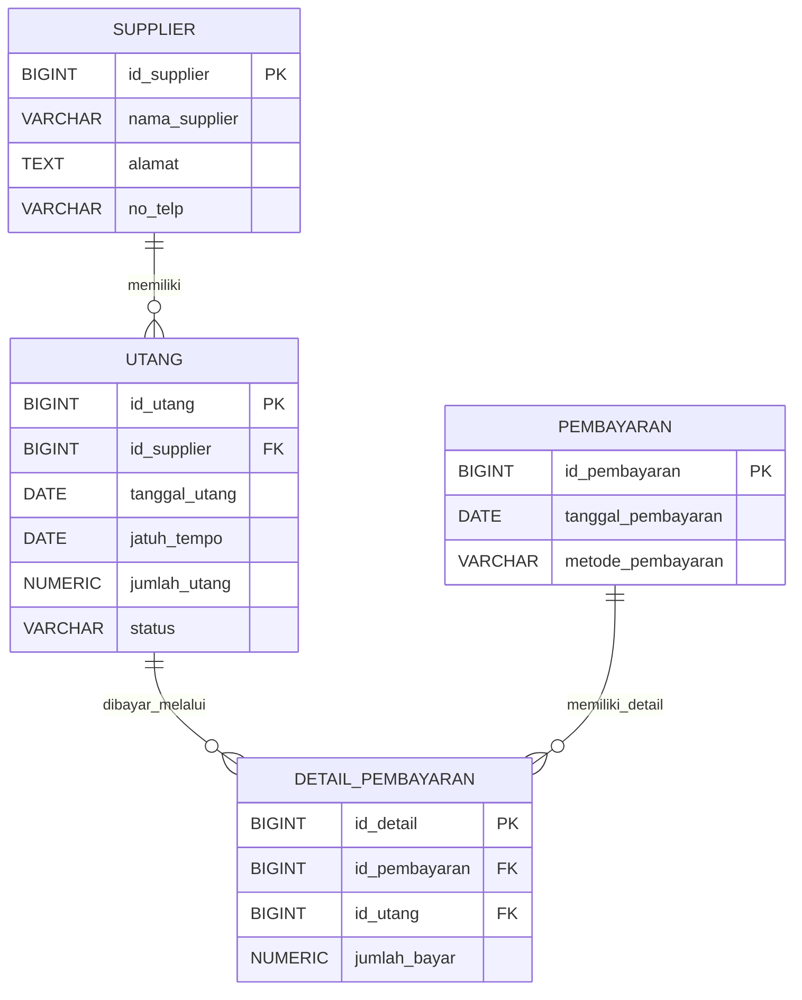

# Sistem Utang dan Pembayaran Supplier

Aplikasi pencatatan supplier, utang, dan pembayaran untuk PT Fatma Furniture. Antarmuka menggunakan HTML, CSS, dan JavaScript, sedangkan penyimpanan data serta logika pembayaran menggunakan PostgreSQL melalui Supabase.

## ERD



Relasi pembayaran dan utang terbentuk melalui `detail_pembayaran`, yang menyimpan nominal alokasi. Kardinalitas pada diagram mengikuti struktur foreign key database; satu pembayaran tanpa detail masih mungkin ada jika dibuat di luar fungsi aplikasi. Penjelasan lengkap ERD, kolom, kendala integritas, alur data, indeks, aturan bisnis, dan keamanan tersedia di [Dokumentasi Skema dan ERD](docs/skema-database-erd.md).

## Fitur

- Ringkasan data utang dan pembayaran pada dashboard.
- Pencatatan dan pengelolaan data supplier.
- Pencatatan utang beserta tanggal dan jatuh tempo.
- Pencatatan pembayaran sebagian maupun pelunasan.
- Pembaruan status utang otomatis: `Belum Lunas`, `Sebagian`, atau `Lunas`.
- Validasi agar jumlah pembayaran tidak melebihi sisa utang.

## Teknologi

- Frontend: HTML, CSS, JavaScript.
- Database: PostgreSQL di Supabase.
- Akses database: Supabase JavaScript client v2 melalui CDN.

## Struktur Proyek

```text
backend/
  config.js                 Konfigurasi koneksi Supabase

database/
  database.sql              Tabel, indeks, RLS, dan fungsi database

docs/
  skema-database-erd.md     Dokumentasi kamus data dan ERD

frontend/
  css/
    style.css               Gaya antarmuka
  html/
    index.html              Halaman utama aplikasi
  js/
    script.js               Interaksi UI dan akses data
```

## Persiapan Supabase

1. Buat proyek di Supabase dan siapkan database PostgreSQL.
2. Buka **SQL Editor** pada proyek Supabase, lalu jalankan isi [`database/database.sql`](database/database.sql).
3. Buka [`backend/config.js`](backend/config.js) dan sesuaikan `SUPABASE_URL` serta `SUPABASE_KEY` dengan URL proyek dan publishable/anon key yang sesuai.
4. Pastikan fungsi RPC dan tabel berhasil dibuat sebelum membuka aplikasi.

Jangan masukkan `service_role` key ke frontend atau repository. Key yang digunakan browser memang bersifat publik; keamanan akses harus ditegakkan melalui kebijakan RLS yang membatasi pengguna.

> **Peringatan keamanan:** kebijakan RLS pada SQL saat ini mengizinkan role `anon` dan `authenticated` melakukan semua operasi pada seluruh baris (`USING (true)` dan `WITH CHECK (true)`). Artinya data dapat dibaca dan diubah oleh siapa pun yang dapat mengakses proyek dengan role tersebut. Konfigurasi ini hanya sesuai untuk demonstrasi atau lingkungan uji dengan data non-sensitif. Sebelum digunakan secara publik atau untuk data operasional, ubah kebijakan RLS dan alur autentikasi agar akses dibatasi sesuai pengguna/otorisasi.

## Menjalankan Aplikasi

Karena halaman memuat library Supabase melalui CDN, jalankan aplikasi melalui web server lokal, bukan dengan membuka file HTML menggunakan protokol `file://`.

Dari direktori root proyek, jalankan:

```powershell
python -m http.server 8000
```

Lalu buka alamat berikut pada browser:

```text
http://localhost:8000/frontend/html/index.html
```

Alternatifnya, gunakan ekstensi VS Code seperti Live Server dan buka `frontend/html/index.html` melalui server tersebut. Koneksi internet diperlukan untuk memuat Supabase JS dari CDN dan mengakses proyek Supabase.

## Alur Data Pembayaran

Frontend memanggil fungsi database berikut melalui Supabase RPC:

- `catat_pembayaran`: membuat transaksi pembayaran dan detail alokasinya, memvalidasi sisa utang, lalu memperbarui status utang.
- `hapus_pembayaran`: menghapus detail pembayaran, menghapus header yang sudah tidak memiliki detail, dan menghitung ulang status utang.
- `perbarui_utang`: mengubah data utang tanpa mengizinkan nilai utang lebih kecil daripada pembayaran yang telah tercatat.

Gunakan fungsi-fungsi tersebut untuk operasi terkait agar aturan konsistensi status dan nominal pembayaran diterapkan.

